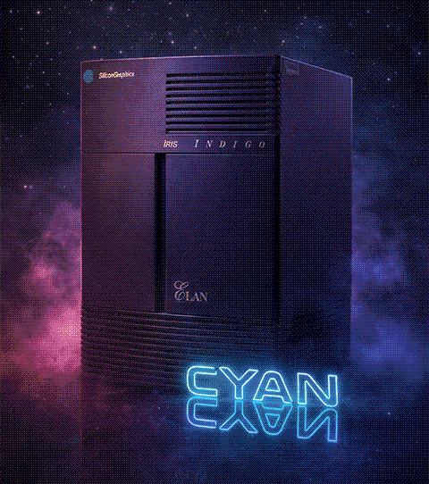
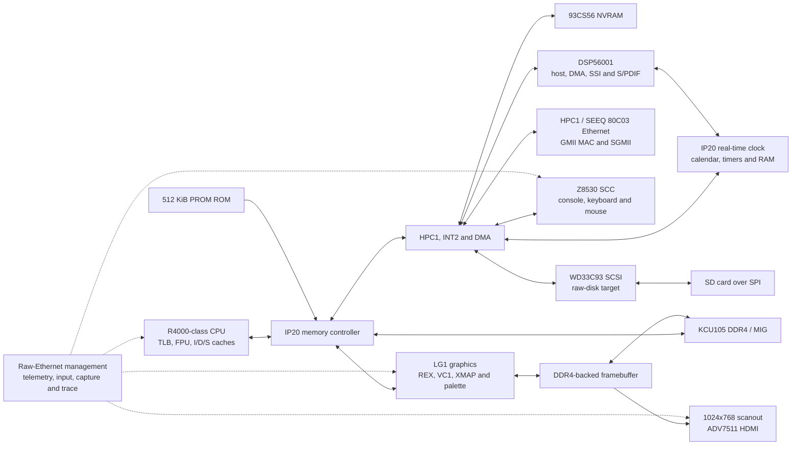

<p align="center">
  
</p>

# CYAN

CYAN is an open FPGA implementation of an SGI Indigo/IP20-compatible
workstation. The design includes an R4000-class CPU subsystem, memory and I/O
controllers, LG1-compatible graphics, SCSI, Ethernet, serial input, and a
DSP56001-compatible audio path. The primary target is the Xilinx KCU105.

CYAN is an independent project. It is not affiliated with or endorsed by
Silicon Graphics, MIPS, Motorola, AMD, or Xilinx.

## Supporting CYAN

There is no tip jar for this project. If you have real SGI hardware or other
vintage computing hardware that you would like to donate to a good home,
please get in touch at
[src@lispm.net](mailto:src@lispm.net).

## Project status

CYAN is a functioning workstation implementation, not a peripheral collection
or a software-only emulator. The public RTL has been synthesized and operated
on a KCU105 with the stock IRIX 5.3 software stack: it reaches the graphical
PROM, boots from the emulated SCSI disk, starts Xsgi, presents a coherent
1024x768 desktop over HDMI, accepts keyboard and mouse input through the
emulated SCC, brings up guest SEEQ Ethernet, and runs.

The HaterMIPS CPU/cache island runs at 100 MHz and has extensive architectural,
differential, stock-diagnostic, and full-system coverage across the integer
core, CP0/TLB, caches, and floating-point unit. CYAN's LG1, HPC1, storage,
network, RTC, interrupt, DMA, and DSP56001/audio paths are production RTL with
focused subsystem and composed-system regressions. The DSP path executes the
installed firmware protocol, normal DMA, SSI framing, and S/PDIF generation;
remaining physical-audio and exhaustive legacy-behavior qualification is
tracked explicitly rather than represented by stubs.

The hardware is largely stable, fast, and correct.

## Hardware architecture

CYAN is a complete workstation-scale SoC rather than a CPU demonstration.
The repository contains the machine-facing IP20 hardware and the board-facing
adapters needed to run it on a KCU105.



### Included machine hardware

| Subsystem | Hardware present in this repository |
|---|---|
| CPU | A [64-bit R4000-class CPU core](https://github.com/KnowledgeEnvironments/H8-MIPS) with CP0, exceptions, TLB, integer ALU, multiply/divide, floating-point unit, and separate instruction, data, and secondary caches. The CPU/cache hierarchy runs as a 100 MHz island in the KCU105 build while the rest of the emulated machine remains at 50 MHz. |
| Memory | The IP20 memory controller, cached and uncached CPU paths, coherent DMA interfaces, PROM mapping, and arbitration into the KCU105's 512-bit DDR4 MIG interface. Main memory and the graphics framebuffer share DDR4 through explicit board-level arbiters. |
| System I/O | HPC1, INT2 interrupt control, timer and DMA machinery, including coordination between storage, Ethernet, DSP, graphics, and CPU/cache traffic. |
| Storage | A WD33C93-compatible SCSI controller, HPC1 SCSI DMA, a raw SCSI disk target, and an SD/SPI block backend. Disk images and operating-system software are not distributed. |
| Network | A SEEQ 80C03-compatible guest Ethernet interface, HPC1 Ethernet registers and DMA, a byte-stream GMII MAC, and KCU105 SGMII/PHY integration. CYAN management frames are separated from guest Ethernet traffic. |
| Serial and input | A Z8530-compatible SCC, serial console routing, keyboard and mouse byte paths, event tracing, and a host-input bridge. On the KCU105, controller input arrives through the management endpoint and follows the emulated SCC path. |
| Graphics | A synthesizable LG1 pipeline: REX command front end and context queue, drawing iterator, line/rectangle backend, clipping and write masks, line cache and write combiner, VC1 timing/state, XMAP/DID selection, palette resolution, hardware cursor, and framebuffer scanout. |
| Display | DDR4-backed LG1 VRAM, independent 64 MHz LG1 serial and 65 MHz video domains, exact frame/tag handling, a 1024x768 HDMI presentation pipeline, ADV7511 configuration, and RGB/frame capture instrumentation. |
| DSP and audio | A DSP56001-compatible core with decoder, ALU, address-generation unit, program/data memories, host interface, interrupts, DMA, peripherals, SSI framing, and S/PDIF transmission to the KCU105 HDMI output. |
| Nonvolatile state | A 93CS56-compatible serial EEPROM initialized from an externally supplied 128-word image. No machine-specific EEPROM contents are distributed. |
| Timekeeping | An IP20 real-time clock with DP8572A-compatible banked registers, BCD calendar counters, hundredths ticks, time-save state, and pageable RAM. The DSP reaches the same clock through its DP8573-compatible Y-memory window. The design also includes the HPC1 8254 programmable timers and MC RPSS counter. |
| Management and observability | A versioned raw-Ethernet endpoint with board/video/scanout status, frame and point capture, keyboard/mouse injection, SCC and LG1 traces, debug probes, and guarded mutable controls. The separate `network-snoop` command is receive-only. |

### KCU105 implementation

The board top level connects the machine to these physical resources:

- 64-bit DDR4 through the Xilinx MIG application interface;
- SGMII Ethernet and MDIO;
- an SD card in SPI mode as the SCSI disk backend;
- the ADV7511 HDMI transmitter, including digital video and S/PDIF audio;
- a UART, GPIO LEDs, and fan PWM; and
- the raw-Ethernet management and input path.

The principal generated clock domains are 100 MHz for the CPU/cache island,
50 MHz for the IP20 machine, approximately 64 MHz for LG1 serial logic,
65 MHz for 1024x768 video, and approximately 300 MHz for the DDR4 MIG user
interface. Checked-in CDC constraints and routed-signoff scripts cover the
CPU island, LG1 serial path, HDMI path, and SGMII receive gearbox.

This inventory describes hardware included in the source tree, not a claim
that every legacy diagnostic, application workload, or physical audio path is
already release-qualified. Generated Xilinx IP, firmware, disk contents, and
bitstreams remain external to the repository.

The public DSP regression boundary and the remaining physical-audio evidence
are summarized in [docs/DSP_STATUS.md](docs/DSP_STATUS.md).

## Repository contents

- `rtl/`: synthesizable machine and peripheral RTL
- `fpga/kcu105_cyan/`: KCU105 integration, constraints, and Vivado flow
- `tools/`: source-build utilities and the raw-Ethernet `cyanctl` controller

The R4000-class CPU is maintained separately as
[HaterMIPS](https://github.com/KnowledgeEnvironments/H8-MIPS) and is pinned into
CYAN at `rtl/cpu`.

Firmware, operating-system images, vendor manuals, generated Xilinx IP, FPGA
bitstreams, and proprietary diagnostic programs are deliberately not included.
Users must supply any firmware or software they are legally entitled to use.

## Requirements

- Verilator and/or Icarus Verilog for portable tests
- Python 3 for test orchestration
- Vivado 2020.1 for the KCU105 implementation
- a separately obtained 512 KiB IP20-compatible firmware image for a bootable
  hardware build

Clone with the CPU submodule and run the public source gate:

```sh
git clone --recurse-submodules <cyan-repository-url>
cd cyan
make test
```

Prepare a legally obtained 512 KiB firmware image and generate the KCU105
project with:

```sh
make firmware FIRMWARE_BIN=/path/to/firmware.bin
make kcu-generate VIVADO=/path/to/vivado \
    EEPROM_INIT_FILE=/path/to/eeprom.hex
```

Firmware-derived memory files and all Vivado-generated source/IP remain in
ignored build directories. Every KCU105 SoC build requires
`EEPROM_INIT_FILE` to name a user-supplied text file containing exactly 128
lines of four hexadecimal digits, one 16-bit 93CS56 word per line. The build
refuses a missing or malformed image rather than silently creating a machine
with erased identity/configuration state. The external file and its SHA-256
are included in the synthesis-input signature, but its machine-specific
contents are not copied into Git.

Run `make help` for the supported source and FPGA targets. Build products are
written below `build/` and are ignored by Git.

## Board management protocol

`tools/cyanctl.py` implements the CYAN raw-Ethernet management protocol. On
Linux, a passive packet decoder can observe the management link without
transmitting:

```sh
sudo python3 tools/cyanctl.py network-snoop --interface IFACE --count 10
```

Status, telemetry, frame capture, input, and trace commands are also available;
run `python3 tools/cyanctl.py --help`. Raw sockets normally require root or
`CAP_NET_RAW`. The protocol is unauthenticated and should be confined to a
dedicated point-to-point or otherwise trusted Layer-2 network. See
[docs/CYANCTL_PROTOCOL.md](docs/CYANCTL_PROTOCOL.md).

## Licensing

CYAN-authored source is licensed under the MIT License; see [LICENSE](LICENSE).
Third-party material retains its original license and is listed in
[THIRD_PARTY.md](THIRD_PARTY.md). The MIT license does not apply to firmware,
operating systems, vendor-generated IP, or other material not distributed in
this repository.

Copyright (c) 2026 I. Finder <src@lispm.net>
